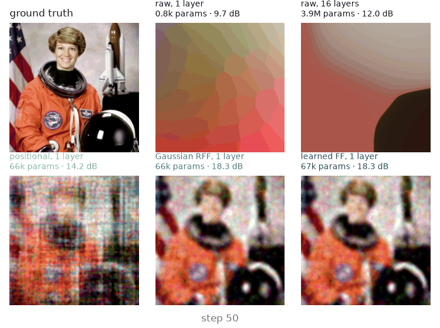
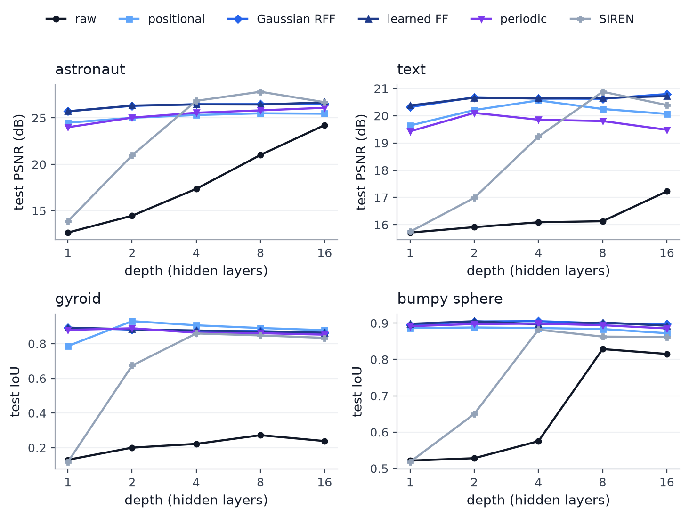
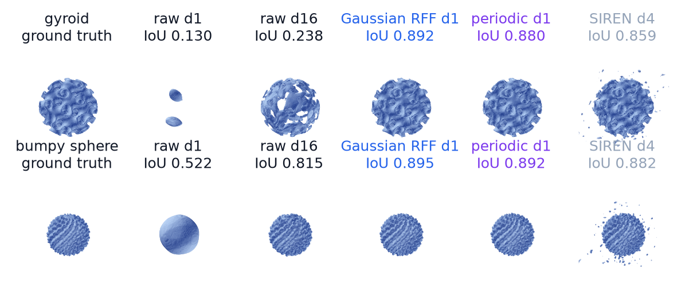
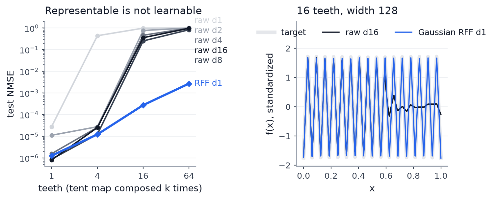
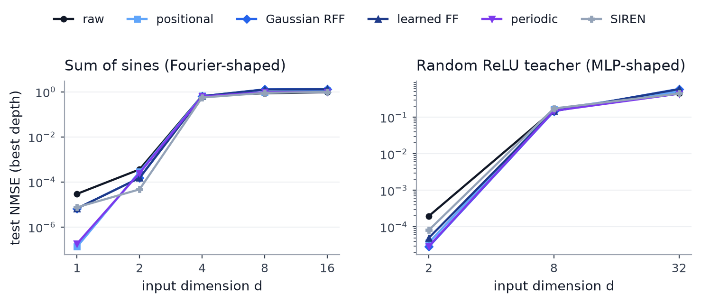
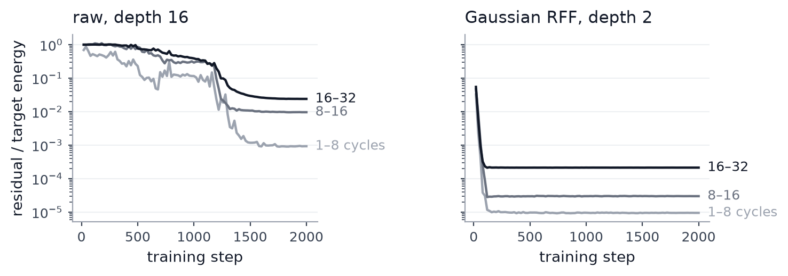
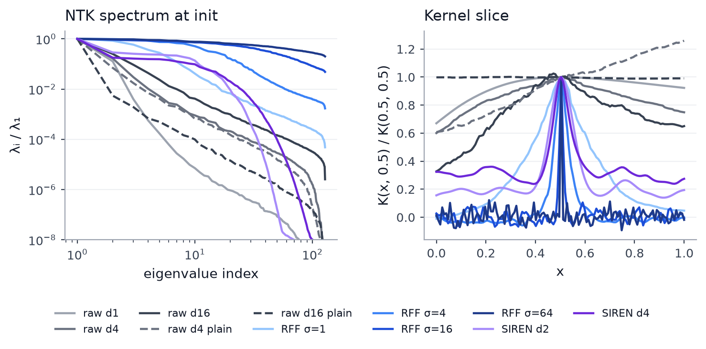

# Fourier Feature Encodings vs. MLP Depth

How much MLP depth does a Fourier-feature input encoding replace?

Six input encodings (raw coordinates, four Fourier-feature variants and SIREN) are trained with ReLU MLPs of 1 to 16 layers on 21 small tasks: 1D signals, images, 3D shapes, synthetic high-dimensional targets and tabular data. Each shallow Fourier model is compared with raw MLPs of every depth and width.



*Training on a quarter of the pixels, held-out PSNR per frame: raw MLPs with 1 and 16 layers vs 1-layer Fourier-feature MLPs.*

## Results

**In 1–3 dimensions, one Fourier layer beats every raw MLP up to 16 layers**, on every target except the smoothest (a single tent). Depth closes the gap only on the photo: the best raw MLP (16 layers, 3.9M parameters, 26.3 dB) is matched by a 2-layer Gaussian RFF MLP with 47× fewer parameters and 5.6× faster inference. On sharp text (17.5 vs 21.0 dB) and on the 3D shapes (gyroid IoU 0.27 vs 0.93) it does not close.





Raw MLPs are trained with and without residual connections. Without them, depth helps faster but training collapses beyond 16 layers; with them, raw MLPs keep improving up to 64 layers, but slowly (22.4 dB on the photo vs 25.7 dB for one Fourier layer at the same width, [ablation](figures/ablations.png)). SIREN, which builds frequencies with sine activations instead of an input encoding, is the best model on both images (27.8 dB with 8 layers), but needs at least 4 layers and its paper learning rate: at 1e-3 it collapses beyond 4 layers.

**Depth can represent high frequencies, but training does not find them.** The tent map composed k times has 2^(k−1) teeth and is computed exactly by a ReLU network of depth k and width 2. Trained raw MLPs fit 4 teeth, fail at 16 (NMSE 0.25) and learn almost nothing at 64 (0.84). A 1-layer positional-encoding MLP fits 64 teeth to NMSE 7e-5.



**The advantage disappears as the input dimension grows.** On targets generated by a random 8-layer ReLU network, Fourier features cut the error 2–4× in 2D, tie at 8D and hurt at 32D (Gaussian RFF NMSE 0.60 vs 0.44 for raw). On sums of plane waves, no model learns the target from 8k samples once d ≥ 4.



**Mechanism: raw MLPs learn low frequencies first; the encoding removes that ordering.** On a 1D sum of sines up to 32 cycles, the best raw MLP still has 2.5% of the target energy left in the 16–32 cycle band after 2k steps. A 2-layer RFF MLP fits every band within 100 steps.



At initialization, 16 residual layers flatten the neural tangent kernel eigenspectrum about 600× (λ₁₀/λ₁), and 16 plain layers make it steeper. One Fourier layer with σ = 1 is 10× flatter than any raw depth, and σ sets the kernel width directly. The kernel at initialization does not explain why the plain body trains better than the residual one: that comes from training, outside the kernel regime.



**On tabular data the gain is small.** Periodic embeddings give the best MLP on both datasets; gradient boosting is still better on California.

| task | metric | raw MLP, best of grid | Fourier MLP, ≤ 2 layers | SIREN, best of grid | GBDT |
|---|---|---|---|---|---|
| astronaut | PSNR ↑ | 26.3 (3.9M) | 26.8 (529k) | **27.8** (116k) | |
| text | PSNR ↑ | 17.5 (3.9M) | 21.0 (529k) | **21.7** (1.8M) | |
| gyroid | IoU ↑ | 0.272 (116k) | **0.934** (527k) | 0.859 (50k) | |
| bumpy sphere | IoU ↑ | 0.830 (1.8M) | **0.915** (529k) | 0.890 (265k) | |
| California | RMSE ↓ | 0.510 (270k) | 0.475 (83k) | 0.654 (1k) | **0.451** |
| covertype | accuracy ↑ | 0.885 (4.0M) | 0.886 (490k) | 0.886 (294k) | 0.816 |

Trainable parameters in parentheses. All tasks and encodings: [results/summary.md](results/summary.md).

## Setup

| encoding | input mapping γ(v) | trainable |
|---|---|---|
| raw | v | – |
| positional | [cos, sin](2π f_j v_i), f_j log-spaced in [1, σ] | no |
| Gaussian RFF | [cos, sin](2π Bv), B ~ N(0, σ²) | no |
| learned FF | Gaussian RFF with B trained | yes |
| periodic | [cos, sin](2π c_ij v_i), c_ij ~ N(0, σ²) | yes |
| SIREN | sine activations in every layer, ω₀ = 30 | – |

- **Model**: γ(v) with m = 256 frequencies, then a ReLU MLP with 1–16 hidden layers of width 32, 128 or 512 (synthetic tasks: 128). Raw MLPs are trained with a plain and a pre-LayerNorm residual body; the better one on validation is reported. An ablation runs both bodies to 64 layers.
- **Training**: AdamW, learning rate 1e-3 (SIREN 1e-4, as in its paper), warmup and cosine decay, 2k–4k steps. σ is selected on validation at depth 2; the test metric is read at the best validation step.
- **Tasks**: 1D sums of sines (max frequency 2–128) and sawtooth (1–64 teeth); sums of sines in 1–16D and random ReLU teachers in 2–32D; two 256² images trained on a quarter of the pixels; two analytic 3D occupancy fields; California housing and covertype (50k subsample).
- **Compute**: one seed, 1,840 runs, 5.7 hours of training on an M5 Pro with [MLX](https://github.com/ml-explore/mlx). Nothing is device-specific; on Linux the same code runs on CUDA with `mlx[cuda]`.

## Limitations

- One seed. The headline gaps (3–5 dB, 0.6 IoU) are far above seed noise; differences of a few tenths of a dB or about 1% accuracy are not.
- One learning rate per model family, not tuned per configuration. Wide plain raw MLPs train worse than narrow ones on the 3D shapes, which suggests the shared rate is too high for them.
- Gradient boosting uses scikit-learn defaults.
- Small datasets (8k–65k training points).

## Reproduce

```bash
pip install mlx numpy pandas scipy matplotlib scikit-learn scikit-image pillow   # Linux + CUDA: mlx[cuda]
./run_all.sh                                   # train.py -> ntk.py -> animate.py -> plots.py, resumable
python train.py --experiment images shapes     # or one experiment at a time
python plots.py depth sawtooth                 # figures; renders written by train.py are not committed
```

## References

- Tancik et al. [Fourier features let networks learn high frequency functions in low dimensional domains](https://arxiv.org/abs/2006.10739). NeurIPS 2020.
- Mildenhall et al. [NeRF: representing scenes as neural radiance fields for view synthesis](https://arxiv.org/abs/2003.08934). ECCV 2020.
- Sitzmann et al. [Implicit neural representations with periodic activation functions](https://arxiv.org/abs/2006.09661). NeurIPS 2020.
- Gorishniy et al. [On embeddings for numerical features in tabular deep learning](https://arxiv.org/abs/2203.05556). NeurIPS 2022.
- Rahaman et al. [On the spectral bias of neural networks](https://arxiv.org/abs/1806.08734). ICML 2019.
- Jacot et al. [Neural tangent kernel: convergence and generalization in neural networks](https://arxiv.org/abs/1806.07572). NeurIPS 2018.
- Telgarsky. [Benefits of depth in neural networks](https://arxiv.org/abs/1602.04485). COLT 2016.
- Malach and Shalev-Shwartz. [Is deeper better only when shallow is good?](https://arxiv.org/abs/1903.03488) NeurIPS 2019.

## License

[MIT](LICENSE)
